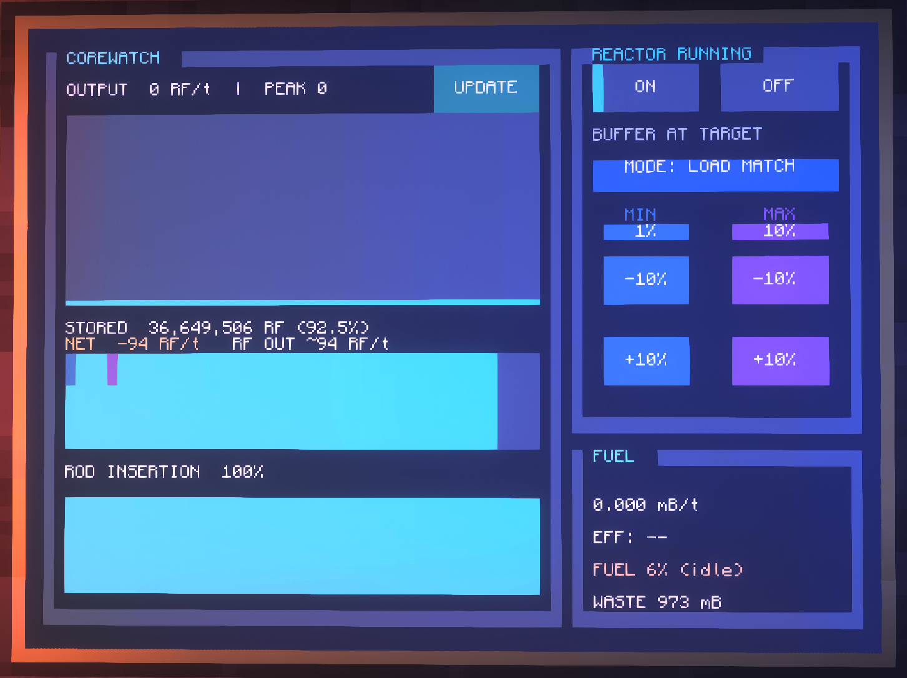
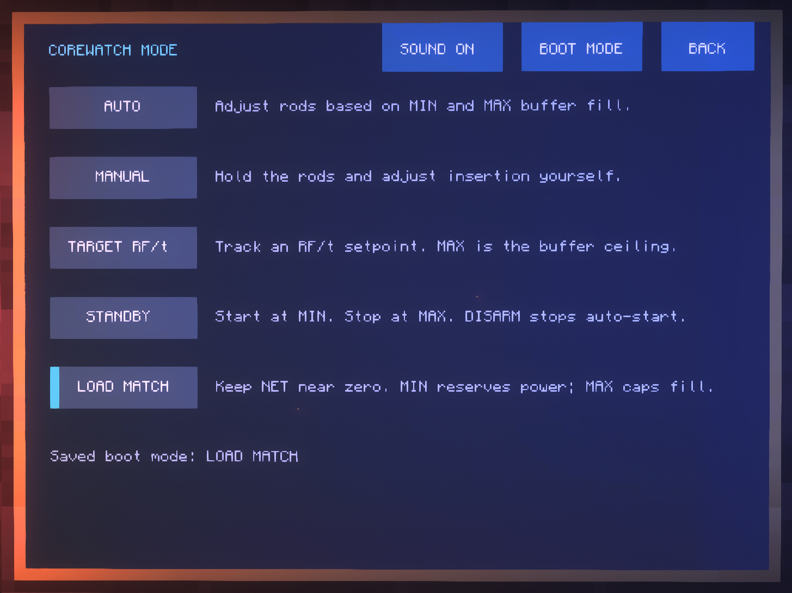

# Corewatch

Corewatch is a touchscreen dashboard and controller for Extreme Reactors in Minecraft. See what your reactor is producing, what your base is drawing, and how much fuel you have left, all from one monitor wall. Manage multiple reactors independently and switch between their dashboards.



## What it does

- Graphs generation in RF/t and shows stored energy, net buffer change, and estimated RF out.
- Tracks fuel, estimated runtime, fuel efficiency, and waste.
- Compares energy, fuel burn, efficiency, and duty cycle across modes in **INFO → STATS**.
- Saves your buffer limits, RF/t target, boot mode, and sound preference.
- Reconnects when each reactor port returns without stopping other controllers, and can check GitHub for updates.
- Lists connected reactors under **MACHINES**, with separate settings, names, histories, and RF session statistics.
- Detects steam reactors and provides steam/coolant readings plus manual power and rod controls.

## Control modes

| Mode | What it does |
| --- | --- |
| **Auto** | Adjusts the rods as the internal buffer fills. MIN is where throttling begins, and MAX is where the rods reach full insertion. |
| **Manual** | Holds rod position until you adjust it. Use the ±10% or ±1% buttons. |
| **Target RF/t** | Tracks an output you choose and backs off at MAX. Tap the RF/t setpoint to enter a number. |
| **Standby** | When armed, starts the reactor at or below MIN and shuts it off at MAX. DISARM shuts it down and disables automatic starts. |
| **Load Match** | Follows estimated demand to keep NET near zero. Below MIN it aims for a surplus, and MAX caps buffer fill. |



Tap **MODE → BOOT MODE** to choose what opens after a reboot. New reactors default to Manual. Each reactor has its own saved boot mode. Standby boots disarmed. Tap **ARM** when you want it to manage starts. Tap the MIN and MAX values to enter them directly where those controls are available.

## Setup

- **Reactors:** One or more Extreme Reactors reactors with **Reinforced Reactor Computer Ports**. Direct RF reactors retain all five control modes. Steam reactors currently have readings and manual controls; automatic steam regulation and turbine control are future work.
- **Computer:** A CC: Tweaked computer connected directly to the reactor port or through a wired modem network. Enable peripheral access on the wired modem attached to the port.
- **Display:** Advanced Monitors joined into a wall. **4 blocks wide by 3 blocks tall** is the recommended setup.
- **Sound:** Optional CC: Tweaked Speaker, connected directly or over the wired network. Toggle cues under **MODE**.

This setup was used on **All the Mods 10 v8.4**.

## Install

Run these commands in the CC computer's terminal. The server must allow CC: Tweaked HTTP downloads from GitHub.

```text
wget https://github.com/TylzSomeone/corewatch/releases/latest/download/corewatch corewatch
corewatch
```

Corewatch keeps the original reactor's configuration in `corewatch-settings.txt`, stores other reactor configurations separately, and records names and assignments in `corewatch-machines.txt`. Back up these files together. To launch automatically, add this line to your CC computer's `startup` file.

```lua
shell.run("corewatch")
```

## Multiple reactors

Tap **MACHINES** in the persistent top bar to select a reactor. All controllers continue working while you browse another dashboard or the paginated machine list. Tap **ALERTS** in the top bar or machine overview to see affected reactor names, ports, specific problems, and suggested checks. Use **OPEN REACTOR** to jump to that machine; **BACK** returns to the previous view. The list updates as faults clear and supports multiple pages. The count represents affected reactors. Current conditions include fuel below 5% (with a distinct empty-fuel message), lost links, incomplete assemblies, paused controllers, and unreadable ports. New ports are discovered automatically; saved missing ports remain listed for diagnosis.

When upgrading an existing installation with several reactors connected, first select the **original reactor** to inherit your old settings. Controllers wait for that choice. Other RF reactors begin in **Manual** and retain their existing power state and rod positions until you change them. Configure each reactor's boot mode separately.

Use **RENAME** on a reactor page, type a name at the CC computer, and press Enter. Escape cancels. Assignments are tied to exact peripheral names; check them after replacing or moving computer ports.

Steam reactors show a thin teal production-history trace in mB/t, percentage gauges for steam and coolant, a rod insertion bar, fuel, waste, temperatures, and full touch buttons for power and ±10%/±1% rod adjustments. The graph adds a sample every two seconds; button presses do not add samples. Empty tanks are labeled EMPTY. Corewatch does not yet coordinate turbines or automatically regulate steam. Only one monitor wall is used in this version; dedicated displays are planned.

There is no fixed reactor-count limit in the code. Automated simulations covered 40 reactors, but real-world capacity depends on the computer, modpack, and wired network. Each controller has a staggered refresh cycle and physical monitor writes are limited to changed rows.

## Updates

Open **INFO → UPDATES → CHECK**. Turn on **BOOT CHECK** if you want Corewatch to check each time it starts. When it finds a newer release, the dashboard's **INFO** button becomes **UPDATE** and opens the update screen.

Tap **INSTALL** when you're ready. Then **open the CC computer's terminal and hold Ctrl+R there**. The new version starts after reboot and keeps your saved settings.

## Troubleshooting

- **Reactor missing:** Run `peripherals` in the CC terminal. Check the cable and enable peripheral access on the modem attached to the Reinforced Reactor Computer Port.
- **Monitor missing:** Connect the Advanced Monitor wall directly or enable its wired modem. Use the 4×3 layout if text or controls look cramped.
- **Download or update fails:** Check whether CC: Tweaked HTTP is enabled and whether the server permits GitHub downloads. You can also download the `corewatch` file from Releases and copy it to the CC computer.
- **Standby waits after a reboot or a lost link:** Tap **ARM** to allow automatic starts again.

## Update log

- **[v1.17.3](https://github.com/TylzSomeone/corewatch/releases/tag/v1.17.3)** — Clickable alert counter and a paginated list of affected reactors, reasons, suggested checks, and OPEN REACTOR buttons. Resolved alerts clear automatically. Improved incomplete-assembly diagnostics.

- **[v1.17.2](https://github.com/TylzSomeone/corewatch/releases/tag/v1.17.2)** — Restored the full startup splash with an animated progress bar, version, and connection/setup messages. It appears once per launch for at least four seconds, regardless of reactor count.

- **[v1.17.1](https://github.com/TylzSomeone/corewatch/releases/tag/v1.17.1)** — Redesigned the steam-reactor dashboard with a thin teal history graph, steam/coolant gauges, a rod bar, and touch buttons. Updated INFO with steam graph and tank guidance.

- **[v1.17.0](https://github.com/TylzSomeone/corewatch/releases/tag/v1.17.0)** — Independent multi-reactor controllers, a shared monitor selector, names, per-reactor settings, connection isolation, and a manual steam-reactor page. Added a third INFO page and migration guidance.

- **[v1.16.4](https://github.com/TylzSomeone/corewatch/releases/tag/v1.16.4)** — Added read-only fuel and casing temperatures for Extreme Reactors.

- **[v1.16.3](https://github.com/TylzSomeone/corewatch/releases/tag/v1.16.3)** — Clarified that you reboot from the CC computer’s terminal. The update screen labels the active version **RUNNING**.
- **[v1.16.2](https://github.com/TylzSomeone/corewatch/releases/tag/v1.16.2)** — The dashboard’s **INFO** button becomes **UPDATE** when a newer release is available.
- **[v1.16.1](https://github.com/TylzSomeone/corewatch/releases/tag/v1.16.1)** — First GitHub release. Added GitHub update checks and on-demand installation.

See [GitHub Releases](https://github.com/TylzSomeone/corewatch/releases) for downloads and full release notes.

You may download and run Corewatch on your Minecraft server.
